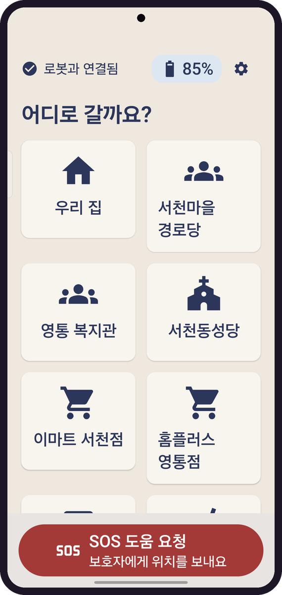
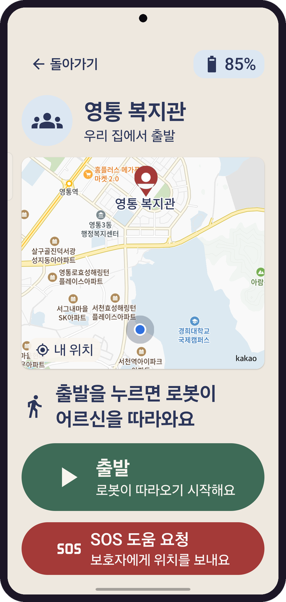
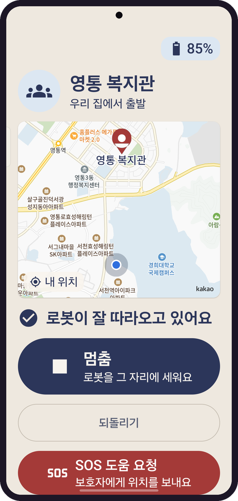
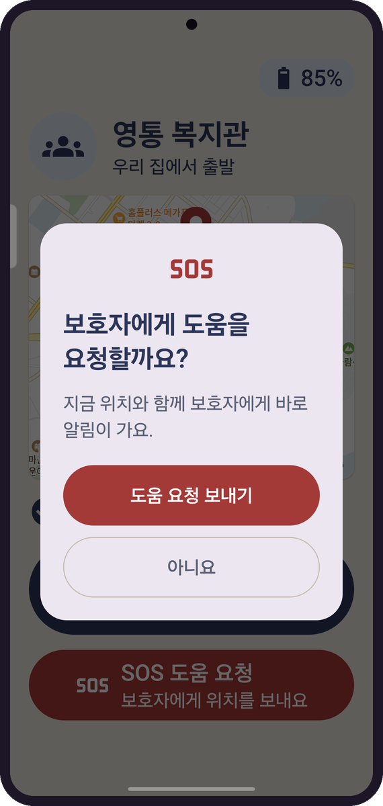
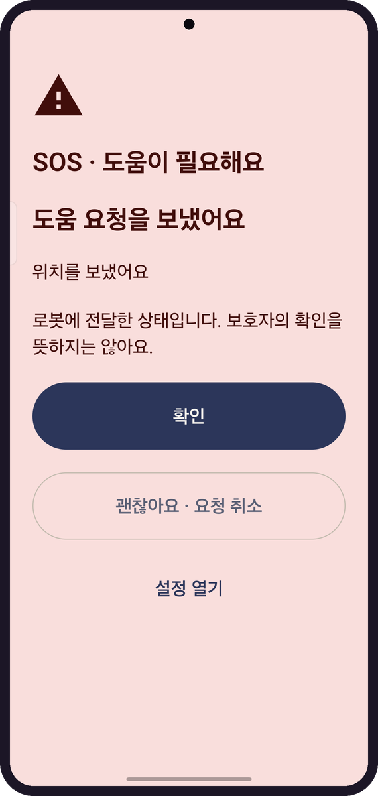

# Senior Care Android

거동이 불편한 어르신이 로봇과 함께 외출할 때 쓰는 안드로이드 앱이다. 목적지를 고르고 출발을 누르면 로봇이 어르신을 따라오고, 도움이 필요하면 SOS로 보호자에게 위치를 보낸다.

| 목적지 고르기 | 출발 전 | 따라오는 중 | SOS 확인 | SOS 보냄 |
| :---: | :---: | :---: | :---: | :---: |
|  |  |  |  |  |

Kotlin과 Jetpack Compose로 만든 단일 모듈 앱이다. 로봇(RPi5)의 폰 브리지에 WebSocket(`phone-bridge/1`)으로 붙고, ROS 2에는 직접 접속하지 않는다.

## 빌드

JDK 21과 Android SDK(platform 37.2, build-tools 37.0.0)가 필요하다. 지원 기기는 Galaxy S26 Ultra(Android 16, minSdk 36)다.

```bash
cp local.properties.example local.properties
# sdk.dir, Kakao 네이티브 앱 키와 REST API 키를 채운다
./gradlew assembleDebug testDebugUnitTest lintDebug
./gradlew installDebug
```


## 로봇에 연결

홈 오른쪽 위 톱니를 1.5초 길게 누르면 설정이 열린다. 로봇 연결에서 자동 탐색으로 로봇을 찾거나, mock을 띄운 PC의 `IP:8765`를 직접 넣는다.

로봇 없이 시험할 때는 mock 브리지를 쓴다. `uv`와 옆 폴더의 `mobile-robot` 저장소가 필요하다.

```bash
tools/mock-bridge/run.sh --scenario default6
```

USB로 연결한 debug 빌드는 loopback으로도 붙는다.

```bash
adb reverse tcp:8765 tcp:8765
# 설정에서 127.0.0.1 / 8765
```

연결을 누르면 위치 포그라운드 서비스가 같이 시작된다. 위치 권한과 기기 위치 서비스가 켜져 있어야 하고, API 37 이상에서는 로컬 네트워크 권한도 묻는다. 알림을 거절해도 앱 안의 SOS와 ACK는 그대로 동작한다. 연결 끊기는 설정이나 연결 알림에서 한다.

브리지는 평문 WebSocket이라 개인 핫스팟 안에서만 쓴다. release 빌드는 사설 IP와 링크로컬 IP만, debug 빌드는 loopback까지 받는다. 지도와 검색은 HTTPS를 쓴다.

## 장소와 SOS

장소는 설정의 장소 프리셋 관리에서 추가하고 고친다. Kakao 장소 검색이나 지도 핀으로 위치와 반경을 정하고, 편집 화면에서 저장을 눌러야 로봇에 반영된다. 그사이 로봇 쪽 목록이 바뀌었으면 최신 목록을 다시 불러와 확인을 받는다. 주행 중에는 저장할 수 없다.

홈 아래 SOS 버튼은 한 번 더 확인한 뒤 로봇에 `sos.raise`를 보낸다. 보낸 뒤 '괜찮아요 · 요청 취소'를 누르면 `sos.cancel`이 간다. 로봇이 SOS를 열면 앱은 다른 명령보다 먼저 수신 확인과 마지막으로 잡힌 위치를 보내고, 30초 동안 새 위치를 더 확인한다. '위치를 보냈어요'는 브리지 ACK를 받은 뒤에 뜬다. 어르신이 확인을 눌러도 로봇이 `sos.clear`를 보낼 때까지 배너와 알림은 남는다.

## 시험

```bash
./gradlew assembleDebug testDebugUnitTest lintDebug
python3 tools/mock-bridge/check.py
scripts/sync-contracts.sh ../mobile-robot/software/contracts
```
